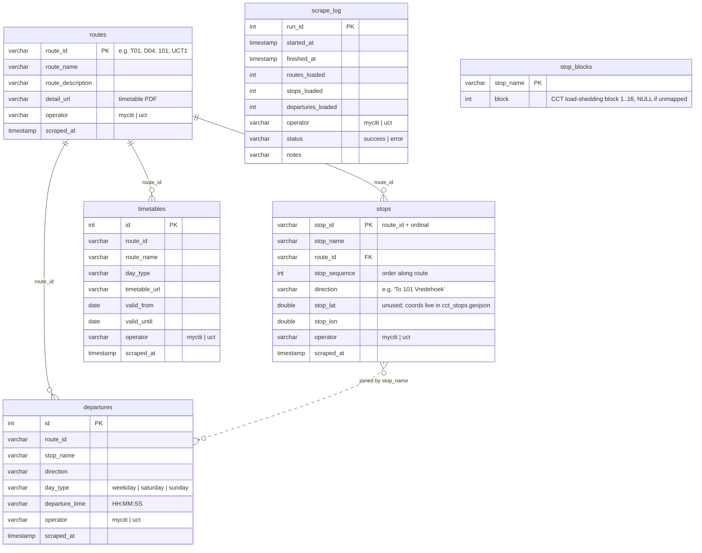

# ⚡ Halte

**Your bus, sorted.** Cape Town's MyCiTi and UCT Jammie shuttle timetables in one place, with no PDF reader required.

> Halte is an independent app, not affiliated with the City of Cape Town, MyCiTi or the University of Cape Town.

---

## The problem 📄😩

Both MyCiTi and UCT publish their timetables as PDFs. One PDF per route. On two different websites. If your trip needs a change between routes, good luck: grab a pen, open six tabs and do the maths yourself.

## The fix 🚌✨

Halte scrapes every one of those PDFs into a little database, then answers the questions you actually have:

- *When's the next bus from here?*
- *How do I get from Big Bay to Gardens?*
- *Where do I change, and how long do I wait?*

It's built from the published timetables, so it's a **planning aid, not live GPS**. Halte will never pretend to know where a bus is right now. It knows where the bus is *supposed* to be, and it's honest about the difference.

---

## What it does

| | |
|---|---|
| 🔎 **Stop search** | Type part of a stop name; Halte matches across both networks. |
| 🧭 **Journey planner** | Direct trips, plus timetable-based connections with one or two changes, showing each leg, the changeover stop and the wait. Best / Fastest / All day tabs. |
| 🗺️ **Journey page** | Tap any result to see every stop on a tube-map style schematic. |
| 🪧 **Departure board** | Leave "To" empty and get the next departures for every route at that stop. |
| 🌍 **Network map** | Every route on real Cape Town geography. Flip between *Schematic* (the tidy 45°/90° look) and *Street* (the actual roads). Tap a stop to see its timetable. |
| 👻 **Trip preview** | Pop a ghost marker on the map where your bus *should* be, interpolated from the timetable. Clearly labelled "Estimated from timetable, not live GPS." |
| ⚡ **Load-shedding awareness** | Shows the stage Halte is assuming (Stage 0 by default) and flags journeys that hit a scheduled outage window at either end. |
| 🎓 **UCT shuttles** | The Jammie timetables live alongside MyCiTi, each route with its own validity dates. Expired ones are hidden and named in a banner, not silently shown. |
| 🔀 **Network toggle** | Both / MyCiTi / UCT on every search. |

### The look

Neo-Brutalist and proud of it: butter yellow `#FFE17C`, black ink, charcoal and sage, 2px borders and chunky offset shadows that buttons press into. Headings are Cabinet Grotesk, body text is Satoshi, both self-hosted (see [`FONTSHARE_LICENCE.md`](FONTSHARE_LICENCE.md)). The whole product, landing page and app alike, shares one token file: [`fastapi_app/static/css/tokens.css`](fastapi_app/static/css/tokens.css). Every text and fill pair passes WCAG AA, and a test checks it.

The nitty-gritty (mobile layout rules, map marker sizes, caching, screen-reader details) lives in [`DESIGN_NOTES.md`](DESIGN_NOTES.md).

---

## Quick start 🏁

Requires Python 3.10+.

```bash
pip install -r requirements.txt
uvicorn fastapi_app.main:app --port 8000
```

Open http://localhost:8000. That's it. No scraping, no API keys, no database server: on first start Halte builds its DuckDB database from the Parquet snapshot committed in `data/snapshot/`.

| Route | Page |
|---|---|
| `/` | Landing page |
| `/search` | Journey search and departure boards (any `/?…` query is redirected here) |
| `/journey` | One trip, every stop |
| `/stop/<name>` | Departure board for a stop |
| `/map` | Network map |
| `/health` | Status, version, DB readiness and data timestamp |

There's also the original **Streamlit** app, which still has a couple of extras (a departure timeline chart and a manual load-shedding stage picker):

```bash
streamlit run app.py
```

## Running the tests 🧪

```bash
pip install -r requirements-dev.txt
pytest
```

The suite covers journey finding and transfers, load-shedding maths, UCT validity dates, the landing page's honesty rules (no "real-time", no fake stars) and brand consistency.

---

## Fresh timetables, please 🔄

The snapshot is only as fresh as the last scrape. To refresh:

```bash
python3 run_etl.py                  # MyCiTi (default)
python3 run_etl.py --uct            # UCT shuttles only
python3 run_etl.py --all            # both
python3 run_etl.py --uct --offline  # UCT from cached PDFs in data/uct_raw/
python3 run_etl.py --inspect        # peek at the DB without scraping
```

Each operator is loaded independently, so refreshing UCT never touches MyCiTi and vice versa. The ETL rebuilds the database **and** re-exports the snapshot. Commit the updated `data/snapshot/*.parquet` files so deploys pick them up.

## How it works ⚙️

```
myciti.org.za timetable PDFs ──┐
                               │  scraped + parsed (requests, pdfplumber)
uct.ac.za shuttle PDFs ────────┘
        │
        ▼
data/myciti.duckdb  ◄── City of Cape Town open data
        │               (stop coordinates, street geometries: data/cct_*.geojson)
        ▼
FastAPI (fastapi_app/) ── Jinja2 templates + Leaflet maps
Streamlit (app.py)     ── Leaflet custom component (map_component/)
```

- **`etl/scrape_myciti.py`** downloads every route's PDF and parses the tables: one row per stop, with day type and direction read from the page headers.
- **`etl/scrape_uct.py`** finds the UCT timetable set that covers today (currently *Consolidation & Exam*, 26 Oct to 20 Nov 2026) and parses it trip by trip. Every route keeps its own validity dates.
- **`etl/load_db.py`** loads about 168,000 departure times into DuckDB (roughly 166.5k MyCiTi and 1.5k UCT) across 55 routes and 540 stops.
- **`system_map.py`** rebuilds each route's stop order from the timetable itself (the first trip of the day visits stops in order), then matches stops by name to the city's official stops layer for coordinates. About 96% land on the map.
- **`journey.py`** finds direct trips and connections. Transfers assume a 3 minute minimum change, cap waits at 45 minutes and try the nearest few changeover stops per line pair.

### Database schema



`departures` is the main fact table. `stops` and `departures` join on `stop_name` rather than a foreign key, because the PDFs only ever name stops; they never number them. Every table carries an `operator` column, which powers the network toggle and the independent ETL runs.

---

## Load shedding, the honest version ⚡

**Which stage?** Halte resolves it in this order:

1. A manual override, if one is set (the Streamlit app has a picker for "what if" checks).
2. The live national stage from [EskomSePush](https://eskomsepush.gumroad.com/l/api), if `ESP_API_KEY` is set. It's checked every 30 minutes, which stays inside the free tier's 50 calls a day.
3. Otherwise, **Stage 0**, and the badge says so (`Stage 0 · default`).

If the API falls over, the app doesn't: it quietly drops to the next option.

**Which stops are affected?** Cape Town sheds power across 16 area blocks. To learn each stop's block:

1. Download the **Load shedding areas** GeoJSON from the [City of Cape Town Open Data Portal](https://odp-cctegis.opendata.arcgis.com/).
2. Save it as `data/cct_loadshedding_areas.geojson`.
3. Run `python3 etl/build_stop_blocks.py` (or the full `run_etl.py`).

Stops outside every polygon stay unmapped. Halte never guesses a block. Without the file, the step is skipped and the flags simply stay off.

**What gets flagged?** [`disruption.py`](disruption.py) rebuilds the city's 16-block rotation (12 two-hourly slots a day, 2h30 outages, the published per-stage offsets). A journey is flagged when the bus is due at its origin or destination while that stop's block is off, and gets a 10 minute buffer per affected end (20 max), because the traffic lights are probably out too. It's a heuristic, not a prophecy. At Stage 0 none of this appears.

More detail: [`LOAD_SHEDDING_BLOCKS.md`](LOAD_SHEDDING_BLOCKS.md).

---

## Deploying 🚀

Production runs:

```bash
uvicorn fastapi_app.main:app --host 0.0.0.0 --port $PORT
```

On a cold start Halte rebuilds `data/myciti.duckdb` from the snapshot if it's missing. It never scrapes on boot, and a missing snapshot fails loudly rather than serving empty boards. A **Render** Blueprint (`render.yaml`) is included for a free web service; free instances nap when idle, so the first visit after a quiet spell is a bit slow. Full details in [`DEPLOYMENT.md`](DEPLOYMENT.md).

## Project map 🗂️

```
├── fastapi_app/
│   ├── main.py                 # App, routers, /health, cache headers
│   ├── routes/                 # landing, search, journey, stop, system_map, api
│   ├── services/               # load shedding, trip preview, UCT validity + notes
│   ├── templates/
│   │   ├── base.html           # App shell: header, footer
│   │   ├── pages/              # landing, index (search), journey, stop, system_map
│   │   └── components/         # connection + transfer cards, trust strip
│   └── static/
│       ├── css/                # tokens.css (shared brand), base, components, landing
│       ├── fonts/              # Cabinet Grotesk + Satoshi (WOFF2)
│       ├── js/                 # combobox, search, tabs, stop filter, journey map
│       └── map/                # Network map page (Leaflet)
├── journey.py                  # Connection finder (direct + transfers)
├── journey_map.py              # Inline Leaflet map for transfer itineraries
├── system_map.py               # Network graph + route colours
├── disruption.py               # Load-shedding schedule model
├── etl/                        # MyCiTi + UCT scrapers, DuckDB loader, stop blocks
├── run_etl.py                  # One-command ETL
├── app.py                      # The original Streamlit app
├── data/                       # Open-data GeoJSON + Parquet snapshot
└── tests/
```

---

## Things Halte can't do (yet) 🙈

- **No live tracking.** Timetables only. If the bus is late, Halte is late too.
- **Public holidays** use the Sunday timetable but aren't detected automatically. Pick Sunday yourself.
- **A few new MyCiTi routes and stops** are missing from the city's open data: 4 routes are drawn as straight dashed lines in street mode, and about 23 stops don't appear on the map (they're still searchable).
- **UCT stops have no coordinates yet**, so they're in search and departure boards but not on the map.
- **UCT Route 5's end date** is 20 Nov in its PDF and 26 Nov on UCT's website. Halte uses the earlier date until UCT confirms (`VALID_UNTIL_OVERRIDES` in `etl/scrape_uct.py`). Route 20 (Educare) isn't in the current set.
- **UCT Routes 13 and 14** each lose their 23:15 weekday trip, because times are stored within a single day and the after-midnight stops would come out in the wrong order. They'll come back once cross-midnight times are supported.
- **UCT footnotes** (Roscommon House after 18:55, via Kramer, via Mowbray and so on) are shown as short notes next to the affected routes, not parsed from the PDFs.
- **Load-shedding flags** always use today's date and check each end of a trip at a single moment. The delay buffer is a fixed rule of thumb.
- **Transfers are suggestions**, not guaranteed connections.

When in doubt, check [MyCiTi](https://www.myciti.org.za) or [UCT Transport](https://uct.ac.za/students/services-transport-parking-uct-shuttle/route-maps-timetables) before you run for the bus.

## Credits 🙏

- Timetables: [MyCiTi](https://www.myciti.org.za) and [UCT Transport](https://uct.ac.za/students/services-transport-parking-uct-shuttle/route-maps-timetables)
- Stop coordinates and route geometries: [City of Cape Town Open Data Portal](https://odp-cctegis.opendata.arcgis.com/)
- Map tiles: © [OpenStreetMap](https://www.openstreetmap.org/copyright) contributors
- Load-shedding stage: [EskomSePush](https://eskomsepush.gumroad.com/l/api) (optional)
- Fonts: Cabinet Grotesk and Satoshi by [Fontshare](FONTSHARE_LICENCE.md)

## License

[MIT](LICENSE). Go build something nice. 🚏
